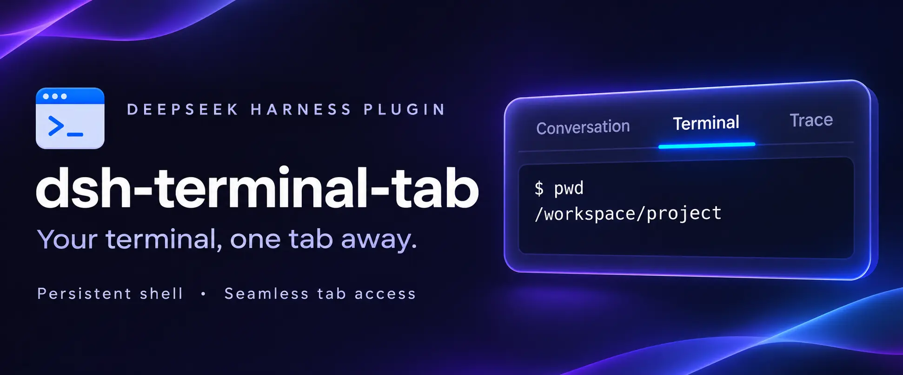
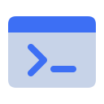
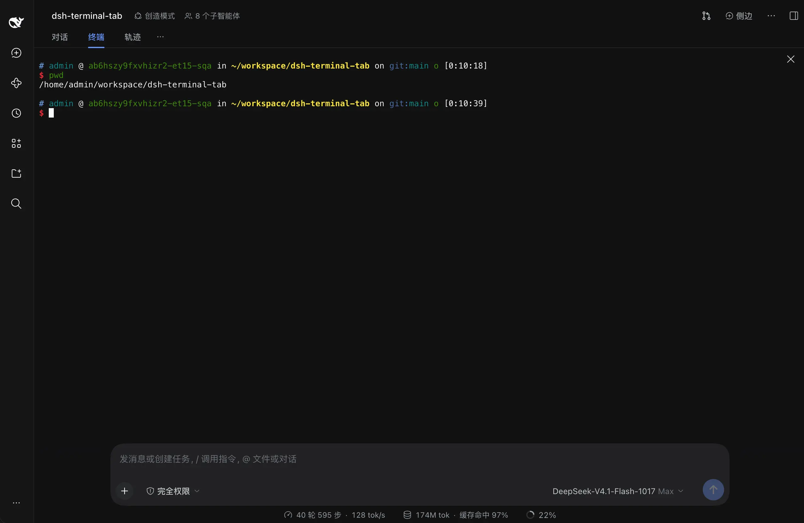

<p align="center">
  
</p>

<div align="center">



# dsh-terminal-tab

**A terminal tab for the Conversation view row of DeepSeek Harness (DSH) — the same persistent shells as the sidebar terminal, mounted as a top tab.**

[](https://www.npmjs.com/package/dsh-terminal-tab)
[](https://github.com/jayhchen/dsh-terminal-tab)
[](./LICENSE)
[](./README.md)
[](./README.zh-CN.md)

</div>

Adds a **Terminal** tab to the top row where "Conversation / Trace" live (after Conversation, before Trace). It behaves exactly like the sidebar terminal — same persistent shells, same auto-recovery — just with the entry point moved to the top.

Works with DSH `0.2.2-rc.2` and later `0.2.x` releases.

## Features

- **Opens straight into a shell**: one fixed terminal per session, started in the session's current working directory
- **Auto-recovery**: refresh the page or reopen the browser and the terminal reconnects, screen content intact
- **Never reclaimed**: switching tabs or sessions never kills it — the terminal keeps running as long as the window stays open
- **Explicit close**: the floating close button (top-right) ends the process; the "closed" state survives page refreshes until you click "New terminal"
- **Default shell**: switch it in Settings → Plugins → Installed → `dsh-terminal-tab` detail page; sidebar terminals follow the same choice
- **After a service restart**: shows "This terminal no longer exists" with a one-click recreate
- The top tab and the sidebar share the same pool of terminal processes

<p align="center">
  
</p>

## Installation

Web:

```
dsh plugin --profile web add dsh-terminal-tab
dsh plugin --profile web update dsh-terminal-tab
```

Desktop:

```
dsh plugin --profile desktop add dsh-terminal-tab
dsh plugin --profile desktop update dsh-terminal-tab
```

## License

[MIT](./LICENSE)
