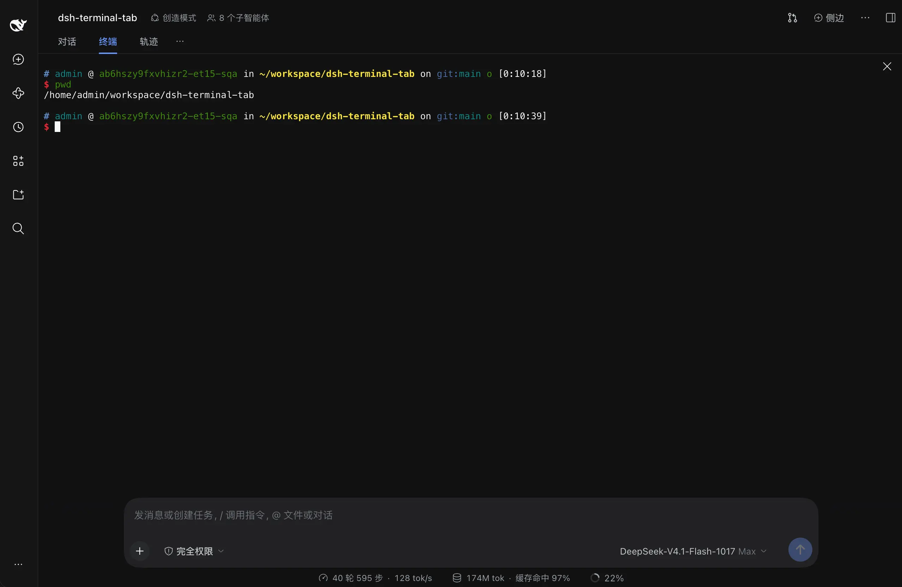

<div align="center">


# dsh-terminal-tab

**在 DeepSeek Harness (DSH) 顶部「对话 / 轨迹」那排 tab 里加一个终端 tab——与侧栏终端同一套持久 shell，只是入口换到顶部。**

[](https://www.npmjs.com/package/dsh-terminal-tab)
[](https://github.com/jayhchen/dsh-terminal-tab)
[](./LICENSE)
[](./README.md)
[](./README.zh-CN.md)

</div>

在 DSH 顶部「对话 / 轨迹」那排 tab 里加一个**终端** tab（落在对话之后、轨迹之前）。行为与右侧栏的终端完全一致——同样的持久 shell、同样的自动恢复——只是入口换到顶部。

兼容 DSH `0.2.2-rc.2` 及之后的 `0.2.x` 版本。

## 功能

- **点开即用**：每个会话固定 1 个终端，直接进入该会话当前的工作目录；
- **自动恢复**：刷新页面、重开浏览器自动连回原终端，屏幕内容还在；
- **不被回收**：切到别的 tab、切会话终端都继续跑，窗口开着就不会被回收；
- **显式关闭**：右上角悬浮的关闭按钮结束进程，「已关闭」状态跨刷新保持，直到点「新建终端」；
- **默认 Shell**：设置 → 插件 → 已安装 → `dsh-terminal-tab` 详情页里切换，侧栏终端同样跟随；
- **服务重启后**：显示「此终端已不存在，请新建终端」，一键新建；
- 顶部与侧栏共用同一批终端进程。

<p align="center">
  
</p>

## 安装

Web（CLI）：

```sh
dsh plugin --profile web add dsh-terminal-tab
```

桌面端：打开应用内**插件**页搜索 `dsh-terminal-tab`。

装完刷新页面即生效。

## 更新

```sh
dsh plugin --profile web update dsh-terminal-tab
```

随后刷新页面。

## 许可证

[MIT](./LICENSE)
